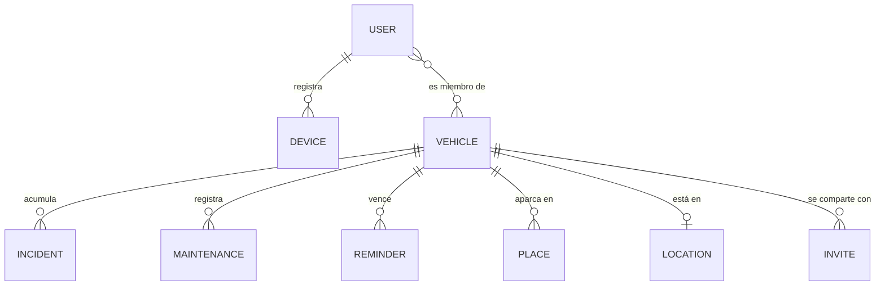

# Modelo de datos — diseño objetivo

Este documento describe **a dónde va** el modelo de datos de AparK, no dónde está hoy. Está
escrito como se diseñaría de cero sabiendo todo lo que la app va a necesitar
(ver [ROADMAP.md](ROADMAP.md)), para que cada spec que llegue pueda comprobar contra qué encaja.

---

## 1. El método

Diseñar para Firestore **no** es diseñar para SQL y luego traducir. El orden correcto es:

```
1. Modelo conceptual        entidades y relaciones (esto sí es igual que en SQL)
2. Patrones de acceso       qué lee y escribe cada pantalla, con qué frecuencia
3. Disposición              colecciones y subcolecciones, derivadas del paso 2
4. Desnormalización         solo la que exija un patrón concreto del paso 2
5. Reglas                   a la vez que el modelo, porque lo restringen
6. Índices                  comprobar que cada consulta del paso 2 tiene uno
```

En SQL modelas el dominio y luego consultas como quieras. **En Firestore diseñas alrededor de las
consultas**, porque el motor solo sabe hacer lo que el índice le permite y la regla le autoriza.

### Las dos leyes que lo gobiernan todo

1. **Las reglas no hacen joins.** Todo campo por el que necesites autorizar tiene que estar en el
   propio documento. Comprobar el padre es posible con `get()`, pero **cuesta una lectura
   facturada** por evaluación.
2. **Una consulta se acepta solo si sus filtros demuestran por sí solos que es segura.** No basta
   con que el resultado fuese legal: Firestore lo verifica *antes* de ejecutarla.

De la ley 1 sale `memberIds`. De la ley 2 sale que la lista de vehículos se obtenga con
`array-contains` y no con una lista de ids guardada aparte.

---

## 2. Modelo conceptual



La relación que manda es **usuario ↔ vehículo, de muchos a muchos**. Todo lo demás cuelga del
vehículo. No existe (todavía) el concepto de *hogar* o *grupo*: ver la sección 7.

---

## 3. Patrones de acceso

Este es el paso que decide el diseño. **Cliente:**

| # | Patrón | Frecuencia | Tiempo real |
|---|--------|-----------|-------------|
| R1 | Mis vehículos, en mi orden, con su ubicación actual | cada arranque | **sí** |
| R2 | Detalle de un vehículo | media | sí |
| R3 | Incidencias abiertas de un vehículo | media | sí |
| R4 | Incidencias abiertas de **todos** mis vehículos | baja | no |
| R5 | Historial de mantenimiento de un vehículo | baja | no |
| R6 | Próximos vencimientos (ITV) de mis vehículos | baja | no |
| R7 | Miembros de un vehículo | baja | no |
| R8 | Ubicaciones predeterminadas de un vehículo | baja | no |
| W1 | **Aparcar** (escribir ubicación actual) | **la más frecuente** | — |
| W2 | Reportar / resolver una incidencia | media | — |
| W3 | Crear, unirse, salirse, reordenar | baja | — |

**Servidor (Cloud Functions, con Admin SDK):**

| # | Patrón | Disparo |
|---|--------|---------|
| S1 | Cascada al borrar un vehículo | trigger |
| S2 | Notificar al resto cuando alguien aparca | trigger |
| S3 | Notificar cambios de incidencia | trigger |
| S4 | **Buscar vencimientos próximos en todos los vehículos** | programado |
| S5 | Cascada al borrar una cuenta | callable — hecho en la [spec 012](specs/012-delete-account/spec.md) |

> **S4 es el que rompe los diseños ingenuos.** Obliga a una *consulta de grupo de colección* sobre
> `reminders`. Lo que lo hace fácil es que corre con el Admin SDK, que **se salta las reglas**: no
> necesita ninguna desnormalización de seguridad, solo un índice de grupo sobre `dueDate`.
>
> Lección general: **los patrones de servidor tienen restricciones distintas a los de cliente.** No
> desnormalices por seguridad algo que solo va a leer una función.

---

## 4. Disposición

```
users/{uid}
  email, displayName, photoUrl
  settings: { locale, theme, notifications: { parked, incidents, reminders } }
  vehicleOrder: [vehicleId]           # SOLO pista de ordenación, jamás la fuente de la lista
  createdAt, updatedAt, schemaVersion

users/{uid}/devices/{deviceId}        # deviceId determinista → registrar es idempotente
  fcmToken, platform, appVersion, lastSeenAt

vehicles/{vehicleId}
  name, licensePlate
  type, powertrain, fuel, make, model, color, emissionsLabel   # ver §9: qué entra, cuándo y cómo
  ownerId                             # quién puede borrar y compartir
  memberIds: [uid]                    # para CONSULTAR y para las REGLAS
  members: { uid: { role, displayName, joinedAt } }   # para PINTAR sin leer N usuarios
  currentLocation: {
    lat, lng, at, by: { uid, displayName },
    placeId?, placeName?, source: "gps" | "manual" | "place"
  }
  createdAt, updatedAt, createdBy, schemaVersion

vehicles/{vehicleId}/incidents/{incidentId}
  vehicleId                           # redundante a propósito: ver decisión 4
  type, title, notes
  status: "open" | "resolved"
  reportedBy: { uid, displayName }, reportedAt
  resolvedBy?, resolvedAt?
  createdAt, updatedAt, schemaVersion

vehicles/{vehicleId}/maintenance/{recordId}
  vehicleId, type, performedAt, odometerKm?, cost?, currency?, workshop?, notes
  createdBy, createdAt, updatedAt, schemaVersion

vehicles/{vehicleId}/reminders/{reminderId}
  vehicleId, kind: "itv" | "insurance" | "service" | "tax" | "custom"
  dueDate                             # índice de grupo de colección — lo usa S4
  recurrence, lastNotifiedAt?
  createdBy, createdAt, updatedAt, schemaVersion

vehicles/{vehicleId}/places/{placeId}
  label, icon: "garage" | "home" | "work" | "other"
  lat, lng
  createdBy, createdAt, updatedAt, schemaVersion

invites/{code}                        # el cliente no lo toca: solo Cloud Functions
  vehicleId, createdBy, createdAt, expiresAt, usedBy?, usedAt?
```

---

## 5. Las decisiones, y por qué

### 1. La pertenencia se guarda **dos veces**, con dos papeles distintos

`memberIds: [uid]` es un array **para consultar y autorizar**. `members: {uid: {...}}` es un mapa
**para pintar**. Parece duplicación y no lo es: son dos patrones de acceso distintos.

- Sin el array no hay `array-contains`, y sin `array-contains` no hay consulta segura (ley 2).
- Sin el mapa, pintar "aparcado por Marta" exige **una lectura por miembro**. Con él, la tarjeta se
  dibuja con el documento que ya tienes.

El precio es mantener los dos sincronizados, y por eso (decisión 3) los escribe solo el servidor.

> **Estado, 2026-11-24**: el mapa `members` **sigue sin existir**. La primera pantalla que enseña
> miembros, la [spec 014](specs/014-vehicle-detail-members/design.md), los pide a una callable,
> `getVehicleMembers`, que lee los `users` con el Admin SDK. R7 es de frecuencia baja y no necesita
> tiempo real, y el mapa habría pedido una migración y mantenerlo desde seis sitios. Lo que sí resolvió
> el mapa en su día, «aparcado por Marta» sin leer N usuarios, ya lo hace `lastLocation.user`.

### 2. El orden vive en el usuario, y **no** es la fuente de la lista

`vehicleOrder` es una **pista**. La lista sale de la consulta; los ids que sobran se ignoran y los
vehículos que faltan van al final. Así un id colgante deja de ser un bug y pasa a ser ruido.

Es la lección de [spec 008](specs/008-vehicle-membership-model/spec.md), y merece enunciarse como
regla general: **un dato derivable no debe ser también la fuente de la verdad.**

### 3. Los datos de autorización los escribe el servidor, nunca el cliente

`ownerId`, `memberIds` y `members` son **datos de seguridad**. Un cliente que pueda escribirlos
puede meter o sacar a gente. Las reglas los deniegan y las mutaciones van por callables
(`joinVehicleWithCode`, `leaveVehicle`, `transferOwnership`).

Regla general: **si un campo decide quién puede leer algo, no puede escribirlo quien es leído.**

### 4. Las subcolecciones llevan `vehicleId` aunque sea redundante

Cuesta nada y es la puerta a las consultas de grupo de colección (R4, S4). Sin él, el día que
quieras "todas las incidencias abiertas" tienes que reescribir documentos existentes.

**Pero no se desnormaliza `memberIds` en los hijos todavía.** Haría falta solo para que R4 fuese
*una* consulta desde el cliente, y obliga a una función que reescriba todos los hijos cada vez que
alguien entra o sale. Con ≤10 vehículos, R4 se resuelve con N consultas pequeñas.

> Principio: **paga la desnormalización cuando exista la consulta, no cuando la imagines.**

### 5. Contadores: primero `count()`, y solo después desnormalizar

Para la chapita de "3 incidencias abiertas", la respuesta por defecto es la **consulta de
agregación** `count()`: siempre correcta, sin nada que mantener. Un contador desnormalizado en el
vehículo se lee gratis, pero **es un pasivo de consistencia** — se desincroniza y hay que
repararlo. Solo se justifica si acaba en la ruta caliente y medida.

### 6. La ubicación actual va **incrustada**, y minimizada

R1 tiene que pintar la tarjeta con lo que ya ha leído: si la ubicación fuese otro documento, cada
arranque costaría el doble de lecturas. Va dentro del vehículo.

Ahora bien, **incrustada no quiere decir entera**: `by` guarda `{uid, displayName}` y nada más. Hoy
se guarda el objeto `User` completo, `userVehicles` incluido, lo que filtra a los demás miembros la
lista de ids de tus otros vehículos.

> Principio: **una copia desnormalizada guarda lo que la pantalla pinta, no el objeto de origen.**

El historial (`parkingEvents`) es otra cosa y llega cuando haya una pantalla que lo pida.

### 7. IDs deterministas donde exista clave natural

`users/{uid}` ya lo hace. `devices/{deviceId}` también debe: si el id sale del token o del
installation id, registrar el dispositivo es **idempotente** y no genera duplicados al reintentar.
Auto-id solo cuando no hay clave natural (vehículos, incidencias).

### 8. Campos comunes en todo documento

`createdAt`, `updatedAt`, `createdBy` y **`schemaVersion`**. El último es el que la gente omite y el
que permite migrar por partes: un cliente viejo puede detectar un documento que no entiende, y una
migración puede avanzar por lotes sabiendo qué le falta por tocar.

---

## 6. Reglas e índices

### Reglas

Sobre el propio vehículo no hace falta leer nada — el campo está en el documento:

```
allow read: if request.auth.uid in resource.data.memberIds;
```

Sobre las subcolecciones hay que mirar al padre, y **cada `get()` es una lectura facturada**
(cacheada dentro de una misma petición):

```
function isMember(vid) {
  return request.auth != null
      && request.auth.uid in get(/databases/$(database)/documents/vehicles/$(vid)).data.memberIds;
}
```

Se acepta ese coste a esta escala. La alternativa —copiar `memberIds` en cada hijo— se compra
cuando duela, no antes (decisión 4).

### Índices

| Patrón | Índice |
|--------|--------|
| R1 `vehicles where memberIds array-contains uid` | automático de campo único |
| R3 `incidents where status == open order by createdAt` | **compuesto** (status, createdAt) |
| R5 `maintenance order by performedAt` | automático |
| S4 `collectionGroup(reminders) where dueDate <= X` | **grupo de colección** sobre `dueDate` |
| R4 `collectionGroup(incidents) …` | pendiente, solo si se implementa |

Todos deben acabar versionados en `firestore.indexes.json`, que hoy está vacío.

---

## 7. Lo que deliberadamente NO se hace

- **No hay entidad `household` / `group`.** Sería el modelado "correcto" para que un garaje se
  comparta entre vehículos, pero implica **un segundo sistema de permisos** en paralelo al de
  vehículos. Las ubicaciones cuelgan del vehículo, y el nombre del sitio se copia dentro de
  `currentLocation` para que la tarjeta lo pinte sin otra lectura. Si algún día aparece el grupo,
  las ubicaciones se mudan y las copias históricas siguen leyéndose bien.
- **No hay `parkingEvents`** hasta que haya pantalla que lo use.
- **No hay contadores desnormalizados** hasta que `count()` se quede corto y esté medido.
- **No hay borrado lógico.** El borrado de un vehículo es real, con cascada en el servidor.

---

## 8. Distancia con lo que hay hoy

| Hoy | Objetivo | Dónde |
|-----|----------|-------|
| `userVehicles` es la fuente de la lista | `memberIds` + `vehicleOrder` como pista | spec 008 |
| `sharedUsers` + `ownerId` | `memberIds` + `members` + `ownerId` | spec 008 |
| Sin marcas de tiempo | `createdAt` / `updatedAt` / `schemaVersion` | spec 008 |
| `lastLocation.user` guarda un `User` entero | `by: {uid, displayName}` | spec 008 |
| `inviteCode` muerto en el vehículo | eliminado | spec 008 |
| Sin metadatos de vehículo (`model` y `color` existen, pero nadie los escribe) | los de §9, cada uno con la función que lo usa | fase 2 y siguientes |
| Sin subcolecciones | `incidents`, `maintenance`, `reminders`, `places` | fase 3 |
| Sin `devices` ni `settings` | necesarios para notificar desde el servidor | fase 4 |
| `firestore.indexes.json` vacío | compuestos y de grupo versionados | según lleguen |

---

## 9. Catálogo de atributos del vehículo

> Redactado y decidido el 2026-11-24, antes de la [spec 015](specs/015-vehicle-data/spec.md), que
> lo implementa. Las decisiones están al final, y **lo construido**, después de ellas.

### El criterio

**Un atributo entra con la función que lo usa**, no antes. `Vehicle.model` y `Vehicle.color` existen
desde el principio «por si acaso», y nada los escribe: son el ejemplo de lo que pasa al revés.

Añadir un campo **después** es barato. Firestore no tiene esquema, y un campo opcional entra con su
valor por defecto en el modelo de Kotlin, sin migrar los vehículos que ya existen. Lo caro es
**cambiar la forma** de un dato que ya han rellenado los usuarios: pasar de texto libre a lista
cerrada, por ejemplo. Por eso las listas cerradas se deciden bien la primera vez, y con tres reglas:

1. **Se guarda un código, no un texto**: `diesel`, no «Diésel». La traducción vive en la app, en los
   tres idiomas, y cambiar cómo se muestra no toca los datos.
2. **Un código desconocido se lee como «otro»** —o como sin dato, en las listas que no tienen
   «otro»—, nunca como un error. Si una versión futura añade
   `hydrogen` a una lista, la app de un miembro que no ha actualizado no puede romperse al leerlo. En
   Kotlin eso significa **no deserializar directamente a un `enum`**, que lanza con un valor que no
   conoce: se guarda como `String` y se traduce con un `fromCode()` que tiene su caso por defecto.
3. **Las reglas validan la lista** (`in [...]`) y las longitudes del texto libre, como ya hacen con el
   nombre y la matrícula.

### Los atributos

| Atributo | Dato | Para qué | Quién lo usa | Cuándo |
|---|---|---|---|---|
| `name` | texto, 1–60 | Distinguir los vehículos | Todo | ✅ existe |
| `licensePlate` | texto, ≤ 15 | Identificarlo; lo pide cualquier aparcamiento | Tarjeta, detalle | ✅ existe |
| `type` | lista | Saber de un vistazo qué es: un icono en el mapa y en la tarjeta | Mapa, tarjeta, detalle; más adelante la ITV, que va distinta para motos | **Spec 015** |
| `powertrain` · `fuel` | dos listas | El sistema (combustión, híbrido, eléctrico…) y qué le echas: no dudar al repostar cuando tienes más de un vehículo | Detalle | **Spec 015** |
| `color` | lista | Encontrarlo en un aparcamiento grande, que es para lo que existe la app | Tarjeta, detalle | **Spec 015** (el campo existe, sin uso) |
| `make` · `model` | texto, ≤ 40 | Identificarlo | Detalle | **Spec 015** (`model` existe, sin uso). Se eligen de una lista mientras escribes, o se escriben a mano si no están: ver abajo |
| `emissionsLabel` | lista, opcional | Saber dónde puedes aparcar: en Madrid y Barcelona decide si entras en la zona de bajas emisiones y cuánto pagas en la zona azul | Detalle; quizá un aviso al aparcar | **Spec 015** |
| `registrationDate` | mes y año | Calcular cuándo toca la ITV, que cuenta desde la primera matriculación, no desde el año del modelo | ITV (3.2) | Con la ITV. Sustituye al `year` que proponía §4 |
| `insurance` | `{company, assistancePhone, policyNumber, renewalDate}` | Llamar a la asistencia ante un golpe o una avería, y el aviso de renovación | Incidencias (3.1), recordatorios (3.2, `kind: "insurance"`) | Con las incidencias |
| `notes` | texto libre, ≤ 500 | Lo que no tenga sitio en otro campo | Detalle | Sin función que lo pida todavía |

**No son atributos del vehículo**, aunque lo parezcan:

- **Los kilómetros.** Cambian cada día, y un valor suelto en el vehículo estaría casi siempre
  desactualizado. Van en cada intervención de mantenimiento (`maintenance.odometerKm`, §4), y el
  último conocido es el de la intervención más reciente.
- **El vehículo por defecto** para el widget y CarPlay, o un alias personal: son de la persona, no del
  vehículo. Van en `users/{uid}`.
- **El garaje y otros sitios habituales**: son `places` (3.4).

**Descartados por ahora**: la foto (necesita Firebase Storage, aplazado con la foto de perfil), la
altura para aparcamientos con gálibo, el número de bastidor (dato sensible sin uso) y los distintivos
de residente.

### Las listas

**`type`** — qué es.

| Código | Español |
|---|---|
| `car` | Coche |
| `motorcycle` | Moto (incluye ciclomotores) |
| `van` | Furgoneta |
| `motorhome` | Autocaravana |
| `other` | Otro |

**`powertrain`** — **el sistema**: qué mueve el vehículo.

| Código | Español | Notas |
|---|---|---|
| `combustion` | Combustión | Solo motor térmico |
| `mild_hybrid` | Microhíbrido | MHEV: ayuda eléctrica, no anda solo con ella |
| `hybrid` | Híbrido | HEV: anda a ratos en eléctrico, no se enchufa |
| `plug_in_hybrid` | Híbrido enchufable | PHEV; incluye los de autonomía extendida |
| `electric` | Eléctrico | BEV: solo enchufe |
| `fuel_cell` | Pila de combustible | FCEV: hidrógeno |
| `other` | Otro | |

**`fuel`** — **qué le echas**. Es la pregunta de quien tiene más de un vehículo y no se acuerda.

| Código | Español | Notas |
|---|---|---|
| `petrol` | Gasolina | |
| `diesel` | Diésel | |
| `lpg` | GLP (autogás) | Incluye los bifuel gasolina-GLP |
| `natural_gas` | Gas natural | GNC y GNL |
| `hydrogen` | Hidrógeno | |
| `other` | Otro | |

**Las dos se combinan**, y la app solo ofrece lo que tiene sentido:

| Sistema | Qué le echas |
|---|---|
| Combustión | gasolina, diésel, GLP o gas natural |
| Microhíbrido, híbrido, híbrido enchufable | gasolina o diésel |
| Eléctrico | nada: `fuel` se queda vacío, y el detalle dice «se carga» |
| Pila de combustible | hidrógeno, sin preguntar |

Las reglas validan cada lista por separado, no las combinaciones: la combinación la cuida la app, y
una mal formada solo se vería rara, no rompería nada.

**`color`** — una paleta cerrada para poder pintar una muestra en la tarjeta, que es lo que ayuda a
reconocerlo de lejos: `white` blanco, `black` negro, `grey` gris, `silver` plata, `blue` azul, `red`
rojo, `green` verde, `yellow` amarillo, `orange` naranja, `brown` marrón o beige, `pink` rosa,
`purple` morado. **Sin «otro»**: no hay muestra que pintar para él, y un color desconocido se lee como
sin color, como la etiqueta.

**`emissionsLabel`** — la etiqueta ambiental de la DGT: `zero` 0 emisiones, `eco` ECO, `c` C, `b` B,
`none` sin etiqueta. La asigna la DGT según el combustible y la antigüedad, y aquí **no se calcula**: la
elige quien edita, porque la regla tiene excepciones y la etiqueta es la que figura en su registro.

### Marca y modelo: de dónde sale la lista

La experiencia que se busca es la de apps como BlaBlaCar: se escribe la marca y una lista debajo va
filtrando las que coinciden; después, el modelo, filtrado por esa marca. La pantalla es sencilla. Lo
difícil son **los datos**: tenerlos completos, al día y con nombres coherentes.

| Opción | A favor | En contra |
|---|---|---|
| **A. Un JSON dentro de la app**, a partir de una lista abierta como [json-car-list](https://github.com/getfrontend/json-car-list) | Gratis, sin conexión, búsqueda instantánea | Es mundial, no europea, y tiene huecos (abajo). Se actualiza al publicar una versión |
| **B. Generarla de los [microdatos de matriculaciones de la DGT](https://datos.gob.es/es/catalogo/e00130502-microdatos-de-matriculaciones-de-vehiculos-mensual)** | Lo que de verdad se matricula en España, oficial y gratis: trae `MARCA_ITV` y `MODELO_ITV` | Nombres sucios (el modelo mezcla versión y motor), así que pide un script de limpieza en `tools/` y repetirlo de vez en cuando. Solo España |
| **C. Una API de pago** (Auto-Data.net, cars-data.com…) | Lo más completo: generaciones y versiones | Coste, una clave que habría que esconder tras una callable, y depender de la red al crear un vehículo |

**Sea cual sea la fuente, hay dos cosas fijas:**

- **Siempre se puede escribir a mano.** Ninguna lista está completa, y un modelo que no aparece no
  puede impedir guardar el vehículo.
- **Se guarda el texto**, sea de la lista o escrito a mano. Así, cambiar de fuente (enriquecer la lista
  con la DGT, o llevarla a una colección `catalog` de Firestore para actualizarla sin publicar la app)
  no obliga a migrar nada.

**Elegida la A** (ver las decisiones). Lo que se comprobó de [json-car-list](https://github.com/getfrontend/json-car-list)
el 2026-11-24:

- **Licencia**: el README la declara MIT, pero el repositorio no tiene fichero `LICENSE` ni línea de
  copyright, y GitHub no la detecta. El permiso vale igual —lo da el autor—, y lo que pide la MIT es
  acompañar los datos con su aviso: el JSON va junto a un `NOTICE` con la atribución y el texto de la
  licencia.
- **Tamaño**: 135 marcas y 1.420 modelos, solo los nombres (sin versiones ni generaciones), en 21 KB.
- **Huecos**: faltan marcas que se venden en España —**Cupra**, Omoda, Jaecoo, KGM/SsangYong— y **no
  hay ninguna moto**. Van en una lista nuestra que complementa a la suya, en un fichero aparte para
  poder actualizar la de ellos sin pisarla.
- **Nombres con tilde**: «Škoda», «Citroën». La búsqueda tiene que ignorar mayúsculas y tildes, o
  quien escriba «skoda» no lo encuentra.

Si la lista se queda corta, la B sigue siendo la mejora natural para el mercado español: los datos de
la DGT traen también las motos.

### Decisiones (2026-11-24)

1. **`fuel` va en dos dimensiones**: `powertrain` (el sistema) y `fuel` (qué le echas), con las
   combinaciones de arriba. Es más exacto que una lista única, y al editar son dos preguntas cortas.
2. **`color`, en paleta cerrada**, con «otro».
3. **`type`, con los cinco tipos** de arriba.
4. **`emissionsLabel` entra**: la de la DGT, opcional. La Crit'Air francesa u otras, solo si alguien
   las pide.
5. **Solo el dueño edita** los datos del vehículo, como ya dicen las reglas.
6. **Marca y modelo, de una lista dentro de la app (opción A)**, con buscador mientras se escribe y
   la salida a mano siempre disponible. El buscador entra en la spec 015, no en una aparte.

### Lo construido ([spec 015](specs/015-vehicle-data/spec.md))

- **Los códigos** viven en `domain/model/VehicleAttributes.kt`, uno por `enum`, y en las reglas, una
  función por lista. **Añadir un código es tocar los dos sitios**, y los dos en la misma versión: la
  app vieja lo leerá como «otro», pero si las reglas no lo conocen, nadie podrá guardarlo.
- **Las reglas validan cada campo solo cuando cambia** (`diff().affectedKeys()`), en el `create` y
  en la rama del dueño. Así, un valor antiguo que ya no valga no impide aparcar ni editar lo demás.
- **La lista de marcas** está en `composeResources/files/catalog/`: `car-list.json` (json-car-list,
  sin tocar), `extra.json` (lo nuestro: las marcas que faltan, modelos de más y las motos) y
  `NOTICE.txt`. Una marca en los dos ficheros suma sus modelos. **Para actualizar la de ellos se
  sustituye el fichero entero** y se apunta el commit nuevo en `NOTICE.txt`; lo nuestro no se toca.
